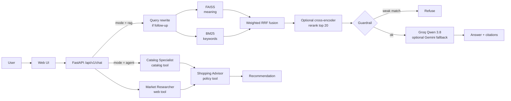

<!-- File: retail-rag-agent/README.md -->
# NovaMart Retail Assistant: Hybrid RAG + Agent Mode

A shopping assistant for a fictional Indian store (NovaMart, 240 products + 5 policy documents).

- **Quick answer (RAG):** meaning search (FAISS) + keyword search (BM25) merged by weighted Reciprocal Rank Fusion, with an optional cross-encoder reranker. The final setup is **chosen by an evaluation search over 21 configurations**, not by guesswork. Answers are grounded with `[n]` citations, follow-up rewriting and an "I don't know" guardrail.
- **Research mode (agents):** three agents built from scratch on Groq's tool-calling API, with no agent framework. They search the catalog with price filters, research buying criteria on the web, check store policies, and write a recommendation.
- **Measured:** an evaluation harness tests 21 retrieval configurations on 139 questions, picks the best within a latency budget, and grades answer quality with an LLM judge.
- **Shipped:** Docker multi-stage image, GitHub Actions CI/CD (lint → tests → build → push to GHCR → deploy to AWS EC2 with a health check), Prometheus metrics, structured JSON logs.
- **Free to run:** Groq free plan (`qwen/qwen3.8-27b`) + local ONNX models for search. Gemini is optional.

---

## 1. How this fixes the three weaknesses

| Weakness | Fix in this project | Where |
|---|---|---|
| No numbers | Golden set of 149 questions (5 types). Retrieval: Hit@k, Recall@5, MRR, nDCG, p50/p95 latency for 21 configurations, per question type. Generation: faithfulness, correctness, citation rate, refusal accuracy. | `eval/` |
| Basic RAG | Weighted hybrid search, optional cross-encoder reranking, BGE query instruction, all tuned by measurement; contextual chunk headers, query rewriting, citation checking, refusal guardrail, metadata filters. | `app/rag/` |
| Vague agent mode | Three named agents, each with one job and one tool, in a fixed workflow. Every tool call is recorded and shown in the UI. Written from scratch, so every step is explainable. | `app/agents/` |

---

## 2. Architecture



**Offline (at Docker build):** `generate_catalog` → `ingest` (chunk, embed, build FAISS + BM25) → artifacts baked into the image.
**Online:** the API loads artifacts once at startup; each request only embeds the query.

---

## 3. Tech stack and why

| Layer | Choice | Why |
|---|---|---|
| API | FastAPI + Pydantic v2 | Type-validated requests, auto docs at `/docs`, industry default for Python ML services |
| Embeddings | `BAAI/bge-small-en-v1.5` via FastEmbed (ONNX) | Strong small model; ONNX avoids a 2 GB PyTorch install, so the image fits a small EC2 |
| Vector index | FAISS `IndexFlatIP` | Exact cosine search, ~1 ms at this size. Same concepts as Pinecone/Qdrant/pgvector |
| Keyword index | BM25 (`rank-bm25`) | Exact matching for SKUs, model numbers and brands, where embeddings are weak |
| Fusion | Reciprocal Rank Fusion | Combines rankings without tuning score scales |
| Reranker | `ms-marco-MiniLM-L-6-v2` cross-encoder | Large precision gain for tens of ms on 20 candidates |
| LLM | Groq `qwen/qwen3.8-27b`, reasoning off | Free plan, fast inference, supports tool calling and JSON mode |
| Agents | Own agent loop on Groq's tool-calling API | ~150 lines you fully understand; no framework dependency |
| Optional | Gemini `gemini-3.5-flash` | Fallback if Groq fails; independent evaluation judge |
| Web search | DuckDuckGo (`ddgs`) | Free, no key |
| Ops | Docker, GitHub Actions, GHCR, AWS EC2, Prometheus, JSON logs | The standard path from laptop to production |

**Free-tier facts to know (Groq, checked October 2026):** Llama models are Enterprise-only now, so Qwen 3.8 is the free general-purpose model. It is labelled *preview*, meaning Groq can replace it at short notice, so the model ID lives in `.env`, never in code. Free limits are 30 requests and 8K tokens per minute; the app keeps prompts small and the Groq SDK automatically waits and retries when it gets a 429 (rate limit) response.

---

## 4. Concepts, explained simply

**Chunking.** The LLM can only read a limited amount, so documents are cut into pieces. Products stay whole (one product = one chunk). Policies are split by section, then by size (900 chars, 150 overlap). Every policy chunk starts with `Document > Section`, so a chunk saying "It costs ₹99" still carries what costs ₹99.

**Embeddings.** A model turns text into a vector (384 numbers) so that texts with similar meaning get nearby vectors. "makes zero noise" ends up close to "fanless, runs silent" even with no shared words.

**FAISS.** Stores all vectors and finds the closest ones to the query vector. Vectors are normalised, so inner product = cosine similarity.

**BM25.** Classic keyword ranking. Rare words in the query (like "Neo 514" or "SKU-LAP-017") weigh a lot. Embeddings blur "Neo 512" and "Neo 514"; BM25 does not.

**Hybrid search + weighted RRF.** Run both, then merge by rank: `score = Σ weight / (k + rank)`. Ranks are used because BM25 and cosine scores are on different scales. The weights matter: the first evaluation showed that with equal weights, BM25's wrong matches on paraphrased questions pushed correct dense results down (semantic Hit@5 fell from 0.93 to 0.63). A lower BM25 weight keeps its strength on exact codes such as SKUs without letting it overrule the better retriever.

**Query instruction.** BGE models were trained with `Represent this sentence for searching relevant passages: ` in front of search queries (not documents). The evaluation tests whether adding it helps on this data.

**Cross-encoder reranking.** An embedding model reads the query and the document separately. A cross-encoder reads them together and is usually more precise, but slower: retrieve 30+30 cheaply, rerank the best 20, keep 5. On this data the first evaluation showed the MS MARCO reranker added ~0.7 s per query and scored below dense search, so it is off by default and only re-enabled if the evaluation shows it wins.

**Query rewriting.** In "Is it waterproof?", "it" means nothing to a search engine. With history, the LLM first rewrites it to "Is the Orbit Ultra 512 waterproof?".

**Grounding and citations.** The prompt allows only facts from the numbered sources, and each fact must cite `[n]`. The API checks which citations are valid and marks those sources as "used".

**Guardrail.** If even the best reranked chunk is a poor match (score below `MIN_RERANK_SCORE`), the bot refuses without calling the LLM, so it cannot invent an answer.

**Tool calling.** You send the model a list of tools as JSON Schema. Instead of text, the model may reply "call `search_product_catalog` with `{"query": "silent laptop", "max_price_inr": 60000}`". Your code runs the function and sends the result back. The model never runs anything itself. Groq uses the same request format as OpenAI's API ("OpenAI-compatible"), the de-facto industry standard, so this code transfers to most providers.

**The agent loop** (`app/agents/agent.py`). Send instructions + task + tool schemas → if the reply contains tool calls, run them and append the results → repeat. Stop when the model answers in plain text, or after `AGENT_MAX_STEPS` rounds, then force a final answer with no tools. Bad arguments and unknown tool names are returned to the model as error text so it can correct itself instead of crashing the run.

**Orchestration** (`app/agents/team.py`). A fixed workflow: two research agents (optionally in parallel), then the advisor with both outputs. A fixed workflow is cheaper and more predictable than letting a "manager" LLM decide who works next.

**Evaluation metrics.** Hit@5: was a correct chunk in the top 5? MRR: how high was the first correct chunk (1, 1/2, 1/3...)? nDCG: overall ranking quality from 0 to 1. Faithfulness: are all claims supported by the sources? (hallucination check)

**LLM-as-judge.** A model grades the answers against a strict rubric. A judge from a different model family (Gemini) avoids a model favouring its own answers; without a Gemini key the report marks the scores as self-graded. Spot-check some verdicts by hand.

**Docker multi-stage build.** Stage 1 installs dependencies; stage 2 copies only the results. Smaller image, no build tools in production, runs as a non-root user.

**CI/CD.** Every push runs lint and tests. A push to `main` also builds the image, tags it with the git commit SHA (so any version can be traced and rolled back), pushes it to GitHub Container Registry, and deploys it to EC2. The deploy fails if `/health` does not respond.

---

## 5. Project structure

```
app/
  main.py            app factory, request-ID middleware, /metrics
  config.py          all settings from environment variables
  api/routes.py      /health, /ready, /api/v1/chat
  rag/               chunking, embeddings, FAISS, BM25, fusion, reranker, retriever, prompts, pipeline
  llm/client.py      Groq (text + tool calling), optional Gemini fallback
  agents/
    tools.py         Tool class + catalog, policy and web-search tools
    agent.py         the agent loop
    team.py          the three agents and their workflow
  memory.py          per-session chat history with TTL
  static/index.html  chat UI with "how this answer was made" panel
scripts/             generate_catalog, ingest, build_eval_set
eval/                golden-set questions, metrics, run_eval
tests/               48 offline unit tests (fake models, scripted LLM, no API calls)
deploy/              EC2 setup script, production compose file
.github/workflows/   CI/CD pipeline
```

---

## 6. Run locally

```bash
python -m venv .venv
source .venv/bin/activate           # Windows: .venv\Scripts\activate
pip install -r requirements-dev.txt
cp .env.example .env                # add GROQ_API_KEY (Gemini optional)

python -m scripts.generate_catalog  # 240 products -> data/raw/catalog.csv
python -m scripts.ingest            # downloads models once, builds artifacts/
python -m scripts.build_eval_set    # 149 questions -> eval/golden_set.jsonl
pytest                              # 48 tests, no keys needed

uvicorn app.main:create_app --factory --reload --port 8000
# open http://localhost:8000  (API docs: /docs, metrics: /metrics)
```

With Docker: `docker compose up --build`.

---

## 7. Evaluate (this produces your resume numbers)

```bash
python -m eval.run_eval retrieval                # no keys, ~5 minutes
python -m eval.run_eval generation --limit 40    # Groq free tier: allow ~10-15 minutes
```

**Retrieval** tests 21 configurations: dense only, BM25 only, weighted hybrids (BM25 weight 1.0 / 0.5 / 0.3 / 0.1 × RRF k 60 / 10), each with and without the BGE query instruction, then the reranker on top of the two best. It prints a ranked table, Hit@5 per question type, and the **exact `.env` lines for the winner** within a latency budget (`--max-p95-ms`, default 300). Paste those lines into `.env`, restart the app, then run the generation evaluation.

Question types: `exact` (full product name), `sku` (bare product code), `semantic` (paraphrased feature), `policy` (customer-style policy question). Each strategy is strong on different types, which is why the per-type table matters more than the overall number.

**Honest reporting.** The winner is picked on the same 139 questions it is scored on, so its score is slightly optimistic (a small grid of 21 settings keeps this effect small). When you report numbers, report the baseline too: "dense only scored X, the tuned configuration scored Y".

Record your results:

| Configuration | Hit@1 | Hit@5 | MRR@10 | p95 latency |
|---|---|---|---|---|
| Dense only (baseline) | | | | |
| BM25 only | | | | |
| Equal-weight hybrid | | | | |
| **Best configuration** | | | | |

## 8. Deploy to AWS EC2

1. **Launch** an Ubuntu 24.04 EC2 instance, `t3.small` (2 GB) or larger. Security group: allow SSH (22) from your IP only, and HTTP (80) from anywhere.
2. **Set up the server:** copy `deploy/ec2-setup.sh` to it and run `bash ec2-setup.sh`. Then create `~/retail-rag-agent/.env` with your `GROQ_API_KEY`.
3. **GitHub secrets** (repo → Settings → Secrets and variables → Actions):
   - `EC2_HOST`: the instance's public IP or DNS
   - `EC2_USER`: `ubuntu`
   - `EC2_SSH_KEY`: the full contents of your `.pem` private key
   - `GHCR_READ_TOKEN`: a GitHub personal access token with `read:packages` (lets the server pull the image)
4. **Create a `production` environment** (repo → Settings → Environments). You can add a required reviewer there to approve each deploy.
5. **Push to `main`.** Open the Actions tab and watch test → build-and-push → deploy. Then open `http://<EC2_HOST>`.

Use an Elastic IP so the address does not change after a restart. Stop the instance when you are not demoing to save cost.

---

## 9. Resume bullets (replace X/Y with your measured numbers)

**Retail RAG Chatbot + Agent Mode** | FastAPI, FAISS, BM25, Groq, Docker, GitHub Actions, AWS EC2
- Built a RAG shopping assistant over 240 products and 5 policy documents; created a 149-question evaluation set (exact names, bare SKUs, paraphrases, policies, out-of-scope) to measure retrieval with Hit@k, MRR and nDCG.
- Found through evaluation that equal-weight hybrid search lowered paraphrase Hit@5 from 0.93 to 0.63; searched 21 fusion/reranking configurations and shipped one reaching X Hit@5 (dense baseline Y) at Z ms p95.
- Added grounded answers with source citations, follow-up query rewriting and refusal of out-of-scope questions (X% faithfulness via LLM-as-judge).
- Implemented a multi-agent research mode from scratch on Groq's tool-calling API (agent loop, schema-validated tools, step budgets, execution traces) with price-filtered catalog search, web research and policy checks.
- Containerized with a multi-stage Docker build and shipped through GitHub Actions CI/CD (lint, 48 unit tests, image push to GHCR, automated EC2 deploy with health checks); added Prometheus metrics and structured logs.

Only state numbers you have measured. Interviewers often ask "how did you measure that?", and you can now answer.

---

## 10. Interview questions to prepare

1. **Did hybrid search help?** Not with equal weights: it hurt paraphrased questions. Dense handles meaning, BM25 handles exact codes like SKUs; weighting the fusion keeps both strengths. Show your per-type table.
2. **Why RRF, not a sum of scores?** The scores are on different scales; RRF needs only ranks. Weights decide how much each retriever is trusted.
3. **Bi-encoder vs cross-encoder?** Separate encoding (fast, precomputable) vs joint encoding (accurate, slow). Hence retrieve-then-rerank.
4. **How do you stop hallucinations?** Source-only prompt, mandatory citations, citation validation, rerank-score guardrail, and measuring faithfulness.
5. **Why did you build agents without a framework?** The loop is small; writing it gave full control over prompts, token budget, retries and tracing, and removed a heavy dependency. Agent frameworks add value for persistence, complex branching and human-in-the-loop, which this project does not need.
6. **How does tool calling work?** The model sees JSON Schemas, returns a tool name + JSON arguments, your code validates and runs it, and sends the result back as a `tool` message.
7. **How do you stop an agent looping forever?** A step budget, then a forced final answer with tools disabled; tool output is truncated to control tokens.
8. **When are agents worth it?** Multi-step, multi-source tasks. They cost more latency and tokens, so simple lookups stay in RAG mode.
9. **How would you scale this?** Redis for chat memory, several containers behind a load balancer, an approximate FAISS index or a vector database, streaming responses, caching, and a paid LLM tier.
10. **Limits of LLM-as-judge?** Bias toward fluent answers and self-preference. Mitigated with a different judge model, a strict JSON rubric, and manual spot checks.
11. **Isn't choosing the best config on your test set cheating?** Partly: it is optimistic. The grid is small (21 settings), I report the baseline alongside, and the fix with more data is a separate held-out test set.
12. **Why was the reranker not always better?** A reranker trained on web search queries (MS MARCO) does not automatically beat a strong embedding model on paraphrased product features, and it costs ~0.7 s per query on CPU. Measure before you add stages.

---

## 11. Next upgrades

Redis for sessions, streaming responses (SSE), HTTPS with Caddy or an AWS load balancer, Amazon ECR with GitHub OIDC (no long-lived keys), a managed vector database (Qdrant or pgvector), tracing with Langfuse, and RAGAS as a second evaluation framework.